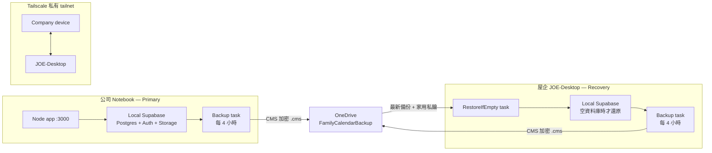

# 雙 Notebook 操作與復原設定

本文按目前安排將**公司 Notebook 視為 Primary**，`JOE-Desktop` 屋企機視為 recovery node。這是操作安排，不是即時複寫：兩部機各自有本機 Supabase，OneDrive 只傳送 CMS 加密備份，不會同步即時資料庫狀態或合併衝突。任何時候只應有一個可寫入的 Primary。

## 架構



備份是 Postgres dump 和 Storage volume 的順序複製，兩者不是原子快照；備份時應避免新增／修改記錄或附件。`.cms` 檔名含主機與時間，每個備份均獨立保留；目前腳本不會自動清除舊備份，需監察 OneDrive 容量。

### Tailscale

1. 在兩部 Notebook 安裝 Tailscale，使用同一個受控 tailnet 登入，並在管理主控台核准兩部裝置。
2. 兩部裝置登入後執行：

   ```powershell
   tailscale status
   tailscale ping JOE-Desktop
   ```

   在屋企機反向以公司裝置名稱執行 `tailscale ping`。成功只代表 tailnet 裝置之間可達，不代表 Supabase 或網站已可由另一部機使用。
3. 不設定 router port forwarding，不把 Postgres `54322` 或 Supabase API `54321` 公開到互聯網。不要把 Tailscale auth key 放進 repo 或文件。

**目前限制：**Supabase Studio/API 設定仍使用 `127.0.0.1`，前端也會使用本機 Supabase URL。因此 Tailscale 本身不會令另一部 Notebook 的瀏覽器直接使用 Primary 網站；跨機直接使用前，需另行設計 tailnet-only proxy／HTTPS、Supabase external URL 與 Auth redirect allow-list。這些設定不在本次文件／測試範圍內。未完成前，將 Tailscale 用作裝置連通性／受控遠端管理；不要宣稱已提供跨機 Web 存取。

## CMS 憑證：`.cer` 公鑰與 `.pfx` 私鑰

備份腳本使用的 thumbprint 為：

```text
82834C3444AD924A67ECD735B79DDFB69E604EA6
```

兩部機的執行帳戶都必須在 `Cert:\CurrentUser\My` 找到此憑證；腳本已使用此 thumbprint。公司機需要憑證公鑰來加密備份；`JOE-Desktop` 屋企機必須在相同 Windows 使用者帳戶的憑證存放區保留私鑰，才能解密還原。

**公司機安裝 `.cer`：只含公開憑證，不含私鑰。**把屋企機桌面的 `FamilyCalendarBackup.cer` 安全複製到公司機，再以實際檔案路徑匯入：

```powershell
Import-Certificate `
  -FilePath (Join-Path $env:USERPROFILE 'Desktop\FamilyCalendarBackup.cer') `
  -CertStoreLocation 'Cert:\CurrentUser\My'

Get-ChildItem Cert:\CurrentUser\My |
  Where-Object Thumbprint -eq '82834C3444AD924A67ECD735B79DDFB69E604EA6' |
  Select-Object Subject, Thumbprint, HasPrivateKey
```

公司機 `HasPrivateKey` 應為 `False`；屋企機 `JOE-Desktop` 應為 `True`。兩部機的 Task Scheduler 必須以匯入該憑證的同一個 Windows 使用者執行備份，因為程式讀取 `CurrentUser\My`。

**`.pfx` 包含私鑰。**本次沒有產生 PFX；一般備份／還原不需要把 PFX 搬到公司機或 OneDrive。不要把 PFX 放入 repo、OneDrive、聊天或公司機。若屋企 Windows 使用者設定檔遺失而必須復原，可只從離線、受控的安全媒體匯入既有的密碼保護 PFX 到 `JOE-Desktop`：

```powershell
$pfxPassword = Read-Host 'PFX password' -AsSecureString
Import-PfxCertificate `
  -FilePath 'D:\Offline\FamilyCalendarBackup.pfx' `
  -CertStoreLocation 'Cert:\CurrentUser\My' `
  -Password $pfxPassword
```

現有私鑰設定為可匯出；上面只匯出了 `.cer`，沒有匯出私鑰。可匯出代表私鑰仍可被另行封裝成 PFX，請避免建立不必要的 PFX。

## 每 4 小時 OneDrive 加密備份

兩部機各自執行：

```powershell
powershell.exe -NoProfile -ExecutionPolicy Bypass `
  -File "C:\完整路徑\scripts\backup-encrypted.ps1" -Mode Backup
```

工作排程器選「每天」觸發，再設定「每 4 小時重複」及「無限期」。備份包括本機 Supabase Postgres dump 和 private Storage volume，使用 CMS 公鑰加密後寫入：

```text
%OneDrive%\FamilyCalendarBackup\
```

使用有 OneDrive、Docker、Node/npm 及 `CurrentUser\My` 憑證的互動式 Windows 帳戶；不要用 SYSTEM。備份前確保 OneDrive 已登入並可同步。公司機只需公鑰即可加密，不應持有家用私鑰。

## 屋企機 Only-if-empty 還原

只在 `JOE-Desktop` 設定：

```powershell
powershell.exe -NoProfile -ExecutionPolicy Bypass `
  -File "C:\完整路徑\scripts\backup-encrypted.ps1" -Mode RestoreIfEmpty
```

建議登入觸發並延遲 2 分鐘，讓 OneDrive 先同步 `.cms`。必須在任何家用機 Backup task 之前先執行還原：若空資料庫先產生了一份最新的空備份，腳本會按時間選取最新檔案。還原只在資料庫指定家庭資料表皆空、Storage `/mnt` 無檔案時執行；任一已有資料便跳過、不覆蓋。`JOE-Desktop` 以外的電腦會跳過還原。

家用機恢復服務後，若將它提升為新的 Primary，先停止公司機的寫入／備份工作，避免兩邊各自接受新資料。還原是單向復原，不是持續同步或自動 failover。

## 工作排程器身份分工

| 工作 | 執行身份 | 原因 |
|---|---|---|
| Wi‑Fi Startup／每 5 分鐘 | 已登入的互動式使用者 | Captive Portal 需要桌面瀏覽器；Wi‑Fi profile 保持 `PENDING_CONFIRM HKG_Airport_Public`，不要自行改名 |
| Supabase watchdog | SYSTEM（最高權限） | 可在開機時檢查／啟動本機 stack；若 Docker Desktop 是 per-user，SYSTEM 可能無權連 Docker daemon，應按實測改用 Docker 所屬使用者 |
| Backup（兩部機） | 有 OneDrive、Docker、Node/npm 及憑證的使用者 | 需要使用者的 OneDrive 環境及 `CurrentUser\My` 憑證 |
| RestoreIfEmpty（只限屋企） | 同一個有 OneDrive 和私鑰的使用者 | 解密需要家用私鑰；SYSTEM 看不到該使用者憑證／OneDrive |

排程建議、日誌路徑及 Wi‑Fi 互動限制詳見 [WIFI_AUTORECONNECT.md](./WIFI_AUTORECONNECT.md)。所有這些自動化腳本都應先在本機手動驗證，再啟用排程。
