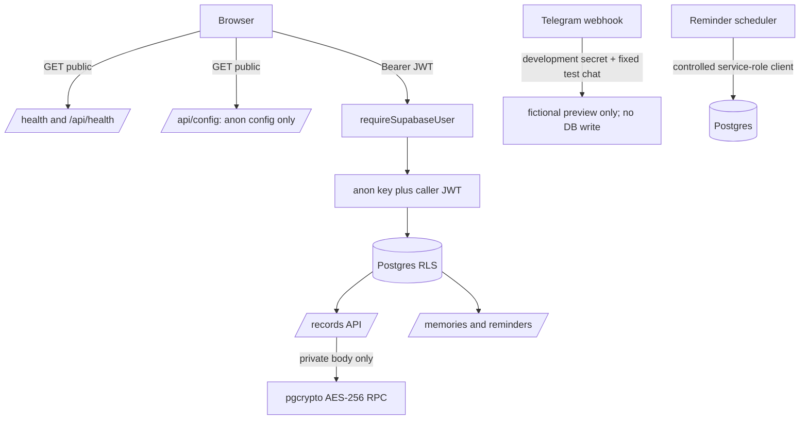

# API Map - JOE-SERVER v1.0

The HTTP routes are registered by `server/index.js` and route modules. Protected endpoints require `Authorization: Bearer <Supabase JWT>`; middleware creates a Supabase client with the anon key and forwards the caller JWT, so database access remains subject to RLS. No service-role key is used for these user-facing routes.

| Method | Path | Auth | RLS / data behavior | Encryption |
|---|---|---|---|---|
| GET | `/health`, `/api/health` | Public | Liveness response only; no DB check | None |
| GET | `/api/config` | Public | Returns validated public URL, anon key and configured family ID | None; anon key only |
| GET | `/api/memories`, `/api/memories/history`, `/api/memories/list` | Supabase user | `family_memories` read with user JWT; RLS same-family active-member check | None; memory content is not encrypted by private-record feature |
| POST | `/api/memories/ingest` | Supabase user | Active membership required; inserts chunks via user JWT/RLS | None |
| POST | `/api/memories/search` | Supabase user | Active membership; orchestrator and search use caller client / family scope | None; local BGE embedding, no external inference |
| POST | `/api/memories`, `/api/memories/save` | Supabase user | Inserts memory with caller JWT/RLS | None |
| GET | `/api/reminders/list` | Supabase user | Active membership; family scoped query and RLS | None |
| POST | `/api/reminders/save` | Supabase user | Active membership; inserts as caller via RLS | None |
| POST | `/api/reminders/toggle` | Supabase user | Active membership; family-scoped update via RLS | None |
| GET | `/api/records` | Supabase user | Active membership; records/attachments queried with caller JWT/RLS | Decrypts private record body through pgcrypto RPC after authorized read |
| POST | `/api/records/batch` | Supabase user; Master/Admin role | Active membership and role checked in route; DB insert remains RLS protected | Private bodies encrypted before insert |
| POST | `/api/records` | Supabase user | Active membership; role/type validation; user JWT/RLS | Private bodies encrypted before insert |
| PATCH | `/api/records/:recordId` | Supabase user | Active membership, record editability and RLS checked | Re-encrypts private content; decrypts only for authorized response |
| DELETE | `/api/records/:recordId` | Supabase user | Active membership, editability and RLS; removes associated private Storage object | Removes encrypted body with the record; no plaintext return |
| POST | `/api/records/:recordId/attachments` | Supabase user | Router-level auth applies; record editability and Storage RLS/bucket policy | Attachment bytes are not covered by records.encrypted_content encryption |
| POST | `/api/telegram/webhook` | No user JWT; development-only secret + test chat ID | Requires NODE_ENV=development and TELEGRAM_DEV_MODE=true; fixed fictional preview only; does not write Supabase | None |

## Service-role boundary

The reminder scheduler is initialized at server startup in `server/index.js` with `SUPABASE_SERVICE_ROLE_KEY` for controlled scheduled processing. It is not the caller identity for HTTP API routes. Seed/admin scripts also use service role only in controlled test/setup contexts. Keep keys out of frontend and logs.

## Mermaid request flow

## Notes

- This is a source-based route map, not an external penetration test.
- Browser-visible `/api/config` must contain only public settings; the anon key is public by design, service-role key is never returned.
- Private record encryption scope is only the private record body. Titles/metadata, attachments, family memories and reminder text are not covered.