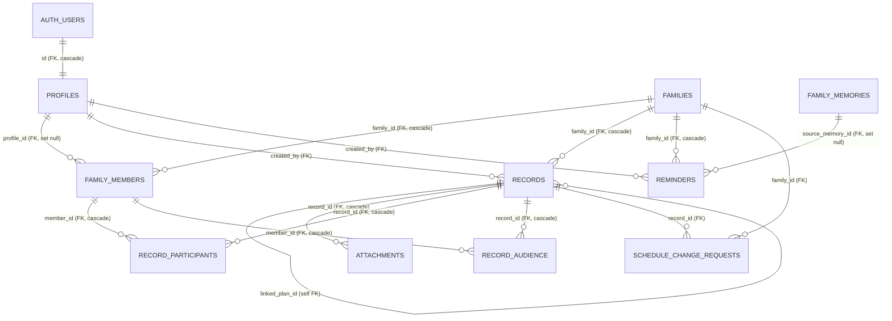

# Database ER Diagram - Production catalog - 2026-10-30

Derived from live PostgreSQL catalog metadata only; no row values are included. Full `\d+` and constraint output: `DB-SCHEMA-FULL-20261030.log`.

## Important modeling details

- `AUTH_USERS` is Supabase `auth.users`; `public.profiles.id` references it with cascade delete.
- `family_members` is the authorization link between profile/account and family. `profile_id` is unique in the current schema, so current model is one profile per family (not multi-family membership).
- `family_memories.created_by` is a text UUID-like value, not a declared FK, and the table has no `family_id`. Same-family access is resolved through RLS helper functions rather than a declared family FK. The Mermaid `FAMILY_MEMORIES` -> `REMINDERS` line is an actual FK only for `reminders.source_memory_id`.
- Records/attachments are not joined to an account by plaintext content. Private body ciphertext is stored in `records.encrypted_content`; metadata remains separate.

## RLS snapshot

- `records`: SELECT/INSERT/UPDATE/DELETE policies target `authenticated`, with helper/creator/family checks; the private plaintext guard trigger is also installed.
- `family_members`: policies support self pending application and family admin/master visibility/update as configured; active `status` and approved role govern authority.
- `families`: authenticated active-member SELECT, admin UPDATE.
- `family_memories`: authenticated same-active-family SELECT and active-member INSERT.
- RLS catalog presence is not a substitute for authenticated semantic regression testing. Never use service role to claim that RLS authorization passed.