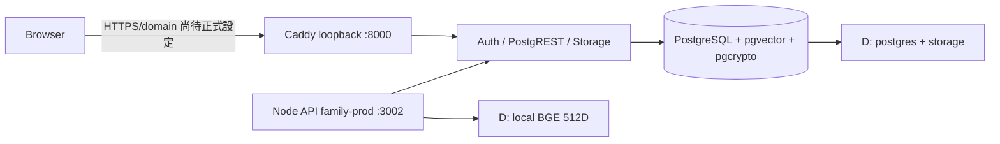

# JOE-SERVER FamilySystem Production README - 2026-10-30

## 老闆摘要

- 目前版本：`v1.0-encrypted-real`，commit `3b1422a`。
- 正式資料只在 JOE-SERVER 的 `D:\docker-data`；DESKTOP 的 C: 及 Cloud 開發環境與 production 分開，沒有自動搬移或匯入。
- 五個 Supabase containers：PostgreSQL、Auth、Storage、PostgREST、Caddy gateway；Node API 由 PM2 `family-prod` 維持，最後檢查 online，`/health` HTTP 200。
- RAG 使用本機真實 BGE 512 維；舊 placeholder 為獨立 384 維。不可混用向量欄位。
- 私人 records 的 `content` 用 pgcrypto AES-256 加密在 `encrypted_content BYTEA`；不等於整個系統端對端加密。

## 架構圖

## 五個容器與資料位置

| 服務 | Container | 用途 |
|---|---|---|
| db | `familysystem-db-1` | PostgreSQL、pgvector、pgcrypto |
| auth | `familysystem-auth-1` | Supabase Auth |
| storage | `familysystem-storage-1` | 私有附件 Storage API |
| rest | `familysystem-rest-1` | PostgREST |
| gateway | `familysystem-gateway-1` | Caddy gateway，綁 loopback |

- `D:\docker-data\family-system\postgres`：PostgreSQL data。
- `D:\docker-data\family-system\storage`：Storage data。
- `D:\docker-data\family-rag\models`：六個本機模型檔案，含 ONNX 512 維 BGE。
- 不要在 production 資料目錄執行未審批清理、prune 或初始化覆寫。

## BGE 與 placeholder

- Real BGE-small-zh：512D，使用 `embedding_bge` 及相應搜尋路徑；runtime local-only，不呼叫外部 AI。
- Legacy placeholder：384D feature-hash，使用 `embedding` 欄位。Fallback log 不代表 real model loaded。
- 本次 local benchmark：100 次 warm-process embeds 平均約 3.57 ms，p50 3.48 ms、p95 4.59 ms；只是本機 smoke benchmark，非吞吐 SLA。中文/英文/混合 threshold 測試僅用六條虛構句子，不可當 accuracy 標準。

## 私人記錄加密範圍

- `pgcrypto` 版本 1.3；`vector` 版本 0.8.2。
- 私人 record body 寫入 `records.encrypted_content BYTEA`，應用經 pgcrypto AES-256 RPC 加解密；read 仍要求用戶 JWT/RLS 授權，資料庫 trigger 拒絕 authenticated private plaintext 寫入。
- Title、其他 metadata、附件、family-memory/RAG 內容不在此加密範圍。沒有 key rotation；key 遺失會令舊 ciphertext 無法解密。
- 不把 key 寫入 Git、log、README 或聊天。另設加密離線 recovery copy，並定期測試還原。

## 環境檔分離

目前並不存在字面名稱 `.env.host` 或 `.env.docker.host`。實際用法按責任分開：

- PM2/Node host app：`DOTENV_CONFIG_PATH` 指向 `D:\backup\.env.docker.prod-backup`。
- Docker Compose interpolation：使用 `--env-file .env.docker`。
- 兩者不可互相替代；任何檔案都不可輸出 key/password。
- 已發現 production env ACL 偏寬：Authenticated Users 有 Modify，Users 有 Read。尚未修改 ACL；需先確認 PM2/Compose 執行身份再安全收窄。

## 開機三步

1. 啟動 Docker Desktop，確認 daemon Running；在 repo 目錄執行 `docker compose --env-file .env.docker -f docker-compose.prod.yml up -d`，等五個服務 healthy。
2. 用持有 PM2 process list 的 Windows 帳戶執行 `pm2 resurrect`，確認 `family-prod` online。`FamilyProdAutoStart` Task Scheduler 工作目前不存在，需另行建立和測試才有 Windows reboot 自動啟動。
3. 執行 `curl.exe --fail http://127.0.0.1:3002/health`，必須 HTTP 200；再做唯讀 DB/schema 檢查。

## 備份策略與現況

- 應採 database-aware PostgreSQL dump + private Storage 備份、加密、校驗和、保留政策、定期隔離還原演練；DB/Storage 與 encryption key 要分開保管。
- 最近 D: disk snapshot 約 2,590 files、1,146,931,958 bytes（歷史快照，並非 backup restore proof）。
- 本次指定 `C:\backup\desktop-dev-20261030.zip` 不存在，不能用該檔還原。C: development archive 即使日後出現，亦不可未驗證就提升為 production。
- Raw PostgreSQL data directory 必須先乾淨停止 PostgreSQL才可複製；優先使用 database-aware dump/restore。

## 常見問題

| 問題 | 解讀 / 處理 |
|---|---|
| `/health` 200 是否代表整個系統正常？ | 只證明 Node liveness；另外看 Compose health、DB、Auth、Storage 和備份狀態。 |
| BGE 維度顯示 384？ | Placeholder/fallback；確認模型路徑、config、local model load log，禁止把 384 寫進 512 欄位。 |
| 私人記錄讀取失敗？ | 先檢查 key recovery、pgcrypto RPC 權限及原用戶 RLS；不可用 service role 假裝通過授權。 |
| Google OAuth callback 失敗？ | 目前 OAuth disabled；`family.example.invalid` 是佔位網址，localhost CORS 不是公開 production origin。先配置 HTTPS 網域及精確 callback。 |
| Docker 全部 down？ | 不要 prune/delete。先保存 log、恢復 Docker daemon，再 compose up、pm2 resurrect 和 health check。 |

## 安全清單與已知風險

- `.env` 和 `.env.docker` 已被 Git ignore；`.env.example` 只有 encryption-key placeholder。
- 五容器健康及 `/health` 200 已驗；records CRUD RLS policies、private plaintext guard 已在 live catalog。
- Production env ACL 過寬待修；Google OAuth `GOTRUE_EXTERNAL_GOOGLE_ENABLED=false`；公開 URL 仍為 `.invalid`，CORS 是 localhost。未配置正式 HTTPS 前不可對外開放。
- RLS catalog 僅證明 policy 存在，語義仍須在 disposable DB 以 authenticated 帳戶驗證。不可在 PROD 執行會插入/刪除 fixture 的測試。
- `C:\backup` 此環境不存在；沒有可供本次驗證的 C: Markdown 或 ZIP。

## v1.1 建議路線

- P0：加密備份 + key 離線 escrow + isolated restore drill；修正 env ACL；對 migration 00010/00011 做 Cloud disposable clone rehearsal，獲批及備份後才手動套用。
- P1：正式 HTTPS 後測試 Google OAuth；設計 versioned-key rotation；用標註本機資料評估 cosine threshold 0.4，無證據先不改。
- P2：先設計多家庭帳戶/RLS/API/UI 模型，再評估 schema；補健康、磁碟與備份失敗告警。

## 參考報告

本次報告：`SOURCE-AUTOPSY-20261030.md`、`API-MAP-20261030.md`、`DB-SCHEMA-FULL-20261030.log`、`ER-DIAGRAM-20261030.md`、`RED-TEAM-REPORT-20261030.md`、`RAG-LAB-20261030.log`、`BACKUP-FORENSICS-20261030.md`、`CHAOS-ENGINEERING-20261030.md`、`PERF-WAR-REPORT-20261030.log`、`NIGHT-SHIFT-START-20261030.log`。
## 文件審閱範圍與缺件

- 已審閱 repository `docs\` 七份 Markdown，以及本輪前六份相關報告（FINAL-PROD-AUDIT、DB-DEEP-DIVE、SECURITY-HARDENING、PERF-BENCH、DISASTER-RECOVERY、ROADMAP）。
- `C:\backup` 目錄在此機器不存在；因此沒有可讀取的 `C:\backup\*.md` 或指定 desktop ZIP，不可把它們當成 recovery source。