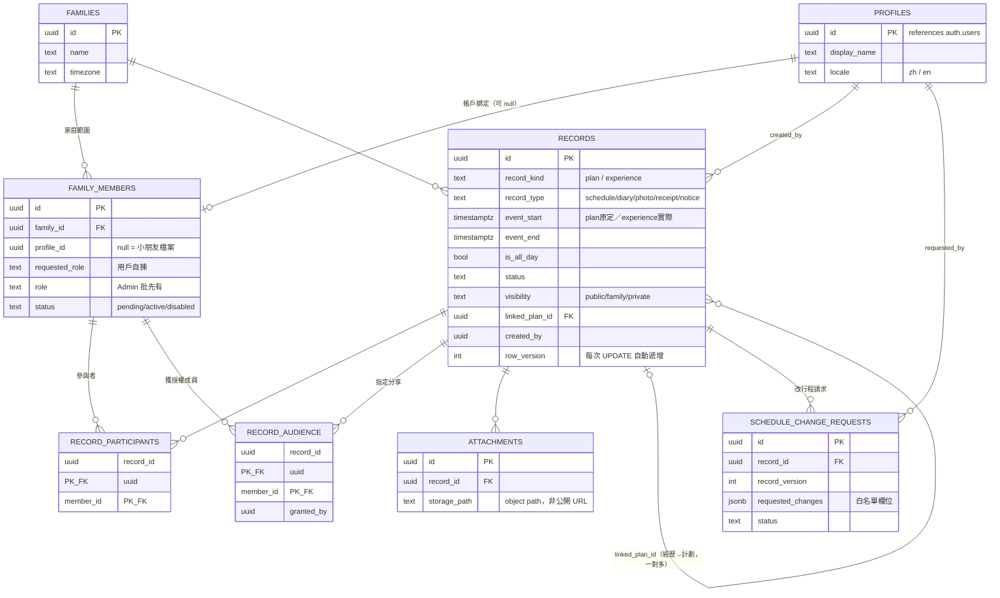

# Family Calendar System — MVP Database Schema 設計文檔

> 日期：2026-10-21（v0.3）
> 依據：Family_Calendar_System_Requirements_v3.md（呢個對話嘅前一份交付物）
> 對應 SQL：`source/DB_SCHEMA_DRAFT.sql`【未驗證草稿 v0.3 — 唔係正式 migration】
> MVP 範圍：FR001 登入、FR002 登出、FR005 簡化版 Timeline/Calendar View、FR011 Helper Workflow

---

## 1. 設計原則對應

| v3 原則 | Schema 落實方式 |
|---|---|
| 記錄係 source of truth，日曆係 view | 一張 `records` 核心表，月曆／時間軸由查詢渲染 |
| 計劃 ≠ 實際發生 | `record_kind` 分 `plan`／`experience`；經歷用 `linked_plan_id` 關聯原定計劃，內容互不覆蓋；完成計劃唔會自動生成歷史 |
| 容許補記 | `experience` 記錄唔要求有對應 plan，直接寫入就得 |
| 身份同權限分開 | `profiles`（身份）同 `family_members`（已批准角色）分開 |
| 姐姐授權制 | `record_audience` 指定分享；family 可見度唔會自動俾姐姐睇到 |
| 限制後端執行 | RLS 政策 + trigger 防護（規格見第 4 節，實作待測試） |

---

## 2. ERD

關係要點：`linked_plan_id` 係一對多 —— 一個計劃可以對應多條經歷記錄（例如原定一日行程，實際分幾日補記）；一條經歷最多 link 一個計劃。

---

## 3. 資料字典

### 3.1 families
家庭範圍。MVP 單家庭，但所有資料掛 `family_id`，將來擴展唔使改結構。

### 3.2 profiles
身份表，1:1 連結 Supabase `auth.users`，新用戶註冊由 trigger 自動建立。只放顯示資料（`display_name`、`locale` —— 工人姐姐 `en`，介面全套英文）。**唔放角色**。

### 3.3 family_members
家庭成員 + 已批准權限。

| 欄位 | 說明 |
|---|---|
| profile_id | 可 null —— null 係冇帳戶成員（小朋友檔案），只可以被標記為參與者 |
| requested_role | 用戶自揀（FR001 流程） |
| role | Admin 批准後先有值；用戶唔可以自批 |
| status | pending／active／disabled —— pending 同 disabled 帳戶全部被拒諸門外（包括私人日記） |

**登入申請流程**：新用戶註冊 → 自動有 profile → 自提一條 pending 嘅 family_members（role 必須 null）→ Admin 審批。初始 Admin 用 service role 建立第一個。

### 3.4 records（核心表）

| 欄位 | 說明 |
|---|---|
| record_kind | `plan`／`experience`，**所有角色都唔可以改**（實作時用 trigger 防護） |
| record_type | `schedule`／`diary`／`photo`／`receipt`／`notice`（用 schedule 唔係 trip，trip 只涵蓋旅行） |
| event_start / event_end | `event_start` 必填（NOT NULL，冇日期嘅記錄日曆搵唔返）；plan 存**原定時間**，experience 存**實際發生時間**，互不覆蓋；CHECK 約束 event_end ≥ event_start |
| is_all_day | 全天活動語義：true 時 event_start 存當地日期 00:00，event_end 係**不包含嘅界線**（例：10 月 21 日全天 = start 21日00:00、end 22日00:00，家庭時區）；顯示層取日期部分 |
| status | plan：active／cancelled；experience：active／final（CHECK 約束） |
| visibility | `public`／`family`／`private` —— public 嘅讀取政策 MVP 暫緩（見第 4 節） |
| linked_plan_id | 經歷關聯返原定計劃；trigger 驗證必須係同家庭嘅 plan；一對多 |
| created_by | 建立者；INSERT 時強制係本人，唔可以冒用；**所有角色都唔可以改** |
| row_version | 樂觀鎖；**每次 UPDATE 由 trigger 自動遞增**，保證版本可靠 |

組合約束（CHECK）：plan 只可以係 schedule；experience 只可以係 diary／photo／receipt／notice。

### 3.5 record_participants
參與者。小朋友冇帳戶都可以被標記。**參與 ≠ 閱讀權限**。實作時要驗證 member 同 record 屬同一家庭。

### 3.6 record_audience
指定分享。姐姐只可以睇「獲授權行程」—— `visibility='family'` 係全家（Master/Admin）可見，**唔會**自動俾姐姐睇到；姐姐要有明確 grant 先讀到。**私人記錄一律唔可以授權**（SQL 已有 trigger 防護），所以冇人可以透過 grant 睇到他人私人日記。實作時同樣要驗證 member 同 record 同家庭。

### 3.7 attachments
附件只存 object path（`{family_id}/{record_id}/{filename}`），唔存公開 URL。表嘅讀寫跟所屬 record 權限；`uploaded_by` 要驗證係操作者本人。**Storage object 本身嘅存取政策未實作**：要驗證 object path 屬於該 record + 調用者有讀取權限，唔可以只靠表嘅 RLS。

### 3.8 schedule_change_requests
改行程請求（FR011）。姐姐想改行程：INSERT 一條 pending 請求（SQL 已有 trigger 驗證：同家庭、目標係 plan、非私人、版本相符、欄位白名單）→ 通知父母 → 父母經受控函式審批。**冇直接 UPDATE 途徑**，所有狀態變更只可以經 `approve_schedule_change()`。

---

## 4. RLS 政策規格（實作前須通過第 7 節測試清單）

SQL 草稿已啟用 RLS 但**冇加任何放行政策**（安全預設：全部拒絕）。以下係政策規格，實作時逐條加上：

### 4.1 統一權限判斷函式

用兩個受控函式做統一入口（避免 RLS 循環依賴），主表、關聯表、附件共用。函式要用 security definer、固定 search_path，並**收窄執行權限**（`REVOKE EXECUTE ... FROM PUBLIC; GRANT EXECUTE ... TO authenticated;`）。

**can_read_record(record_id)** —— 判斷順序（重要：先驗證活躍身份同家庭範圍，再處理 private）：
1. 操作者唔係**該記錄所屬家庭**嘅活躍已批准成員（active + role 已批）→ 一律 false（**包括 private owner**：停用帳戶連自己嘅私人日記都讀唔到）
2. `visibility='public'` → MVP 唔建立、唔開放讀取政策 → false（public 只係預留值）
3. `visibility='private'` → 只有 `created_by = auth.uid()`
4. Master/Admin → 家庭內非私人記錄全部可讀
5. Worker 及其他角色 → 只有：(a) 自己建立嘅記錄 (b) 獲 record_audience grant 嘅記錄

**can_edit_record(record_id)**：
1. 唔係該記錄所屬家庭嘅活躍已批准成員 → false
2. `visibility='private'` → 只有 `created_by = auth.uid()`
3. Master/Admin → 家庭內非私人記錄
4. Worker → 只有自己建立嘅 experience diary/photo

### 4.2 各表政策

| 表 | SELECT | INSERT | UPDATE | DELETE |
|---|---|---|---|---|
| families | 活躍成員 | — | Admin | — |
| profiles | 本人 + 同家庭 Master/Admin（要核對目標同家庭，唔可以跨家庭讀） | — | 本人（只限顯示資料） | — |
| family_members | 本人 + 同家庭 Master/Admin | 自提 pending（role 必須 null）／Admin | Admin（審批角色） | Admin（service role） |
| records | can_read_record | 本人名義（created_by = auth.uid()）+ Master/Admin 任何／Worker 只有 experience diary/photo | can_edit_record | can_edit_record |
| record_participants | can_read_record（跟 record） | can_edit_record | can_edit_record | can_edit_record |
| record_audience | can_read_record | 同家庭 Master/Admin | — | 同家庭 Master/Admin |
| attachments | can_read_record | can_edit_record + uploaded_by 係本人 | can_edit_record | can_edit_record |
| schedule_change_requests | 提出者 + 同家庭 Master/Admin | 本人 + pending + 活躍成員 | **冇政策**（唯一途徑係審批函式） | 冇 |

### 4.3 不可修改欄位（trigger，實作時加，對所有角色生效包括 Master/Admin）

- `created_by`／`family_id`／`record_kind`：一律唔可以改
- `record_type`／`visibility`／`linked_plan_id`：只有 Master/Admin 可以改

### 4.4 審批函式規格 — approve_schedule_change(request_id, approve, note)

唯一可以改變請求狀態嘅途徑（security definer）：
1. 鎖定請求同行程記錄（`for update`，防審批期間被改）
2. 只有同家庭 Master/Admin 可以審批
3. 重新驗證：請求同記錄同家庭、目標係 plan、非私人
4. 版本檢查：請求嘅 `record_version` 必須等於記錄現時 `row_version`，唔係就拒絕（要重新提出）
5. 只套用白名單欄位（title、content、event_start、event_end、is_all_day、status）；`row_version` 由 bump trigger 自動遞增
6. 更新請求狀態、決定人、時間 —— 全部同一 transaction 完成

---

## 5. 設計假設

1. 單家庭：一個帳號最多屬於一個家庭（`unique(profile_id)`）
2. `record_kind` 用值約束而非分表：plan 同 experience 共享大部分欄位，分表會令時間軸查詢複雜
3. 樂觀鎖 + transaction 內鎖定，足夠應付家庭規模嘅並發
4. RLS = 應用層隔離（v3 私隱層次一）；service role 仍可讀取

## 6. 待決事項

| # | 項目 | 影響 |
|---|---|---|
| 1 | 私隱層次一 vs 層次二（用戶端加密）【待確認】 | 層次二嘅話，private 內容嘅儲存、解鎖、搜尋限制都要重新設計，唔係加欄位就搞掂 |
| 2 | 系統 MFA 實作【待確認】 | 唔影響表結構，影響 auth 流程 |
| 3 | Guest 公共搜尋 | MVP 暫緩；`visibility='public'` 已預留，讀取政策遲啲先開 |
| 4 | Storage object 存取政策 | 規格已定，未實作未驗證 |
| 5 | 函式執行權限 | 實作 RLS 時要 REVOKE/GRANT EXECUTE，唔可以淨係寫註解 |

## 7. 測試清單（實作 RLS 後逐項驗證，必須用 authenticated 身份）

1. 停用（disabled）帳戶：連自己嘅私人日記都讀唔到
2. 本人私人日記：另一半（Master）SELECT 唔到；grant audience 都救唔到
3. Worker 對未獲授權嘅 family 行程 SELECT 唔到；獲 grant 先讀到
4. Worker 不能 UPDATE／DELETE／INSERT 任何 plan 記錄
5. Worker 不能將 diary 改成 schedule／改 visibility／冒用 created_by
6. Master 都唔可以改 created_by／family_id／record_kind（trigger）
7. profiles：唔可以跨家庭讀其他家庭嘅 profile
8. participants／audience：member 同 record 唔同家庭時被拒
9. 附件：冇 record 讀取權限攞唔到 storage object（Storage 政策實作後）
10. 改行程請求：Worker 不能直接 UPDATE scr；版本不符時 approve 被拒
11. approve_schedule_change() 對私人記錄／另一家庭記錄／非 plan 全部拒絕
12. linked_plan_id 指向另一家庭記錄／經歷記錄時被 trigger 拒絕
13. 註冊流程：新用戶自動有 profile，可以自提 pending 申請，唔可以自批

> **狀態聲明**：SQL 檔係未驗證草稿（唔係正式 migration）—— RLS 政策同審批函式仲未實作，要按呢節測試清單實作並通過之後，先可以當正式 schema 用。
